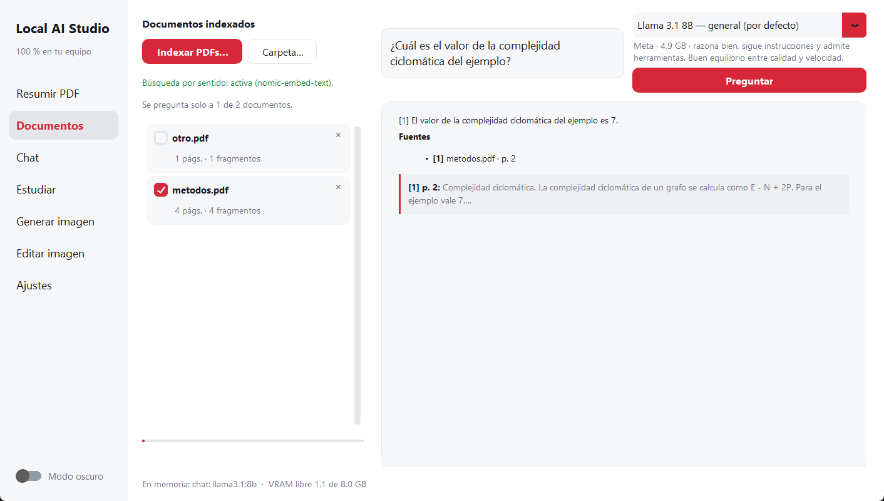
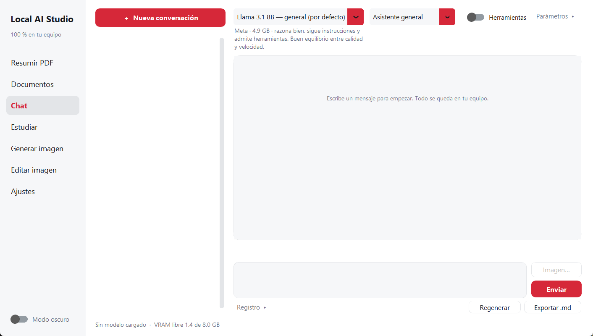

# Local AI Studio

Asistente de IA **100 % local** para Windows: resume PDFs con fórmulas y código **sin inventar nada**, responde a tus propios
documentos **citando la página**, conversa, ayuda a estudiar, genera y edita imágenes, y puede ejecutar acciones sencillas en tu PC
**solo con tu permiso**. Nada de lo que escribes ni de tus documentos sale del equipo: sin nube, sin cuentas, sin telemetría.

   

Pensado para una GPU de 8 GB (RTX 4060) y 16 GB de RAM, pero se adapta al hardware que detecta. Interfaz simple: fondo blanco,
modo oscuro opcional, acento rojo.

<p align="center">
  
  
</p>

## Qué hace

| Sección | Qué hace |
|---|---|
| **Resumir PDF** | PDF → Markdown fiel (código, tablas, **fórmulas LaTeX reconstruidas desde el propio PDF**) con verificación, e informe de fidelidad. Exporta `.md`, `.pdf` y `.docx`. Cola de carpetas con reanudación. |
| **Documentos** | Pregunta a tus PDFs: búsqueda híbrida (palabras + sentido), respuestas con **página citada** y comprobación de citas y cifras. Eliges en qué documentos preguntar. |
| **Chat** | 6 modelos con descripción (Llama 3.1 por defecto), roles (tutor, programador, seguridad defensiva…), historial, imágenes para el modelo de visión, Markdown + LaTeX. Interruptor **Herramientas**. |
| **Estudiar** | Tarjetas (CSV para Anki), preguntas de práctica y ejercicios paso a paso con cada igualdad marcada ✓ / ✗ / ⚠. Ejecuta el código en un sandbox. |
| **Generar imagen** | Stable Diffusion 1.5 y SDXL en fp16, lote 1–4, semilla, guardar, copiar, enviar al editor. |
| **Editar imagen** | Recorte, giros, tamaño y filtros con vista previa; guarda PNG, JPEG o WebP. |
| **Ajustes** | Diagnóstico de GPU/VRAM/PyTorch, modelos, almacenamiento con limpieza segura y estado de la barrera de red. |

El inventario completo, con límites, está en **[docs/CAPACIDADES.md](docs/CAPACIDADES.md)**.

## Inicio rápido (Windows 10/11)

1. Instala [Ollama](https://ollama.com) y [Python 3.12](https://www.python.org).
2. Crea el entorno e instala las dependencias:
   ```bash
   python -m venv venv
   venv\Scripts\python.exe -m pip install -r requirements.txt
   ```
3. Abre la aplicación con doble clic en `run.bat` (o `venv\Scripts\python.exe -m local_ai_studio`). La primera vez crea
   `config.yaml` desde `config.example.yaml`.
4. Descarga los modelos desde **Ajustes** (con confirmación) o a mano:
   ```bash
   ollama pull llama3.1:8b
   ollama pull qwen2.5:7b
   ollama pull qwen2.5vl:7b
   ollama pull nomic-embed-text
   ```
   Opcionales: `gemma2:9b`, `mistral:7b`, `qwen2.5-coder:7b`.

**Para generar imágenes** instala además PyTorch con CUDA (la versión de PyPI es la de CPU) y las librerías de difusión; los pasos
están en [requirements-images.txt](requirements-images.txt). Comprueba en **Ajustes** que PyTorch muestra «con CUDA».

¿Algo no va? `venv\Scripts\python.exe -m local_ai_studio --doctor` imprime un diagnóstico (dependencias, GPU, Ollama y modelos).

## Documentación

| Documento | Para qué |
|---|---|
| [docs/CAPACIDADES.md](docs/CAPACIDADES.md) | Todo lo que hace la aplicación, sección por sección, y lo que **no** hace |
| [docs/ARQUITECTURA.md](docs/ARQUITECTURA.md) | Capas, hilos, flujo de «Resumir PDF», memoria de vídeo y decisiones de diseño |
| [docs/AUDITORIA.md](docs/AUDITORIA.md) | Auditoría técnica: calificación, hallazgos corregidos y deuda conocida |
| [SECURITY.md](SECURITY.md) | Modelo de amenazas, defensas, pruebas y límites honestos |
| [CONTRIBUTING.md](CONTRIBUTING.md) | Cómo colaborar y qué se exige a un cambio |
| [CHANGELOG.md](CHANGELOG.md) | Historia de versiones |

## Seguridad en una línea

Barrera de red que bloquea cualquier conexión que no sea a `localhost`, visor sin imágenes externas ni enlaces, descargas solo de
listas cerradas y con hash, la aplicación **nunca instala paquetes por su cuenta**, y un asistente de acciones que **nunca** escribe,
ejecuta ni abre nada sin enseñarte la acción exacta. Detalle y límites en [SECURITY.md](SECURITY.md).

## Fidelidad: por qué se puede confiar en el resumen

Un modelo de 7B alucina si reescribe mucho texto técnico. Por eso el nivel por defecto, **Texto limpio**, no deja que ningún modelo
reescriba el contenido: se **extrae y se comprueba**. Las fórmulas se reconstruyen desde la fuente, el tamaño y la línea base de cada
símbolo del PDF; se leen además dos veces con visión y se contrastan; las cifras, las cadenas numéricas, las identidades (sympy) y el
código se verifican con código. Lo que no se puede comprobar sale con ⚠ y dice **qué símbolo** difiere. Todo en
[docs/CAPACIDADES.md](docs/CAPACIDADES.md#1-resumir-pdf).

## Calidad

```bash
python -m pip install -r requirements-dev.txt
python -m ruff check .                                   # 0 errores
python -m mypy local_ai_studio                           # 0 errores
python -m unittest discover -s tests                     # 330 pruebas, sin Ollama ni GPU
python -m bandit -r local_ai_studio app.py -ll           # 0 hallazgos
```
La integración continua (GitHub Actions) ejecuta lo mismo en cada cambio. La capa de lógica tiene un 81 % de cobertura; la interfaz
se prueba abriendo la ventana real en un proceso aparte con datos temporales.

## Estructura

```
app.py                       punto de entrada (equivale a python -m local_ai_studio)
run.bat · build_exe.bat      lanzador con doble clic · empaquetado .exe (PyInstaller)
config.example.yaml          plantilla de configuración y prompts (config.yaml es local)
local_ai_studio/
  core/    rutas, configuración, cliente de Ollama, barrera de red, VRAM, almacenamiento, visor Markdown, exportación
  pdf/     extracción, fórmulas desde glifos, verificación (sympy), limpieza, resumidor
  chat/    motor de Ollama, historial SQLite, roles, renderizado seguro
  agent/   política de rutas, herramientas, bucle con permisos, sandbox
  rag/     índice híbrido de documentos y comprobación de respuestas
  study/   tarjetas y verificación de pasos
  images/  catálogo y descarga verificada, generación (diffusers), edición (Pillow)
  ui/      ventana principal y páginas (CustomTkinter)
tests/                       330 pruebas
docs/                        capacidades, arquitectura y auditoría
```
Datos de usuario (fuera de git): `config.yaml`, `resumenes/`, `imagenes/`, `conversations/`, `outputs/`, `models/`, `workspace/`, `logs/`.
Con `LOCAL_AI_STUDIO_HOME` puedes moverlos todos a otra carpeta.

## Versión empaquetada (.exe)

`build_exe.bat` genera `dist\LocalAIStudio\LocalAIStudio.exe` (≈ 270 MB). Sirve para PDF, documentos, chat, estudiar y editar
imágenes. **No incluye PyTorch** (no genera imágenes) **ni el sandbox** de código; para eso usa `run.bat`. Sigue necesitando Ollama.

## Preguntas frecuentes

**¿Tiene restricciones éticas, o hay que entrenarla?** Las restricciones y el conocimiento están en los pesos de cada modelo (Llama,
Qwen, Gemma, Mistral), fruto de su entrenamiento; esta aplicación **no los modifica** ni ofrece versiones «sin censura». Su
conocimiento acaba en su fecha de entrenamiento y puede equivocarse, por eso la app comprueba con código lo que se puede comprobar. No
hace falta entrenar nada para usar tus documentos: lo cubre **Documentos**. Para trabajo de seguridad legítimo hay un rol
«Seguridad (defensiva)».

**¿Puede controlar todo el PC?** No, y es deliberado: ocho herramientas cerradas, las que cambian algo piden tu permiso con la acción
completa. Ver [docs/CAPACIDADES.md](docs/CAPACIDADES.md#4-asistente-con-herramientas-acciones-en-el-pc).

**Licencias de los modelos.** Stable Diffusion 1.5: CreativeML OpenRAIL-M; SDXL: CreativeML OpenRAIL++-M; los de Ollama, cada una la
suya. Léelas antes de un uso comercial.

## Licencia

[MIT](LICENSE) para el código de este repositorio. Los modelos que descargas tienen sus propias licencias.
