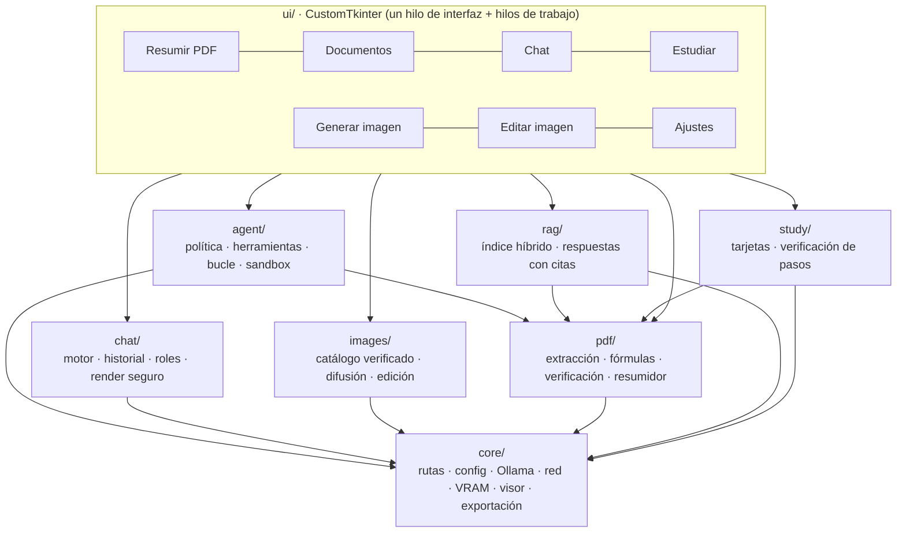
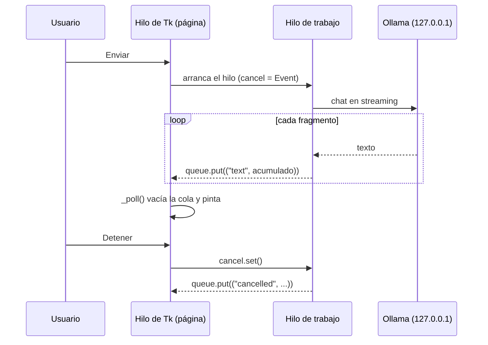
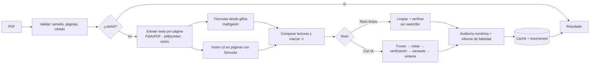

# Arquitectura

Cómo está construido Local AI Studio y por qué. Para *qué hace*, mira [CAPACIDADES.md](CAPACIDADES.md).

## Vista general

**Regla de capas** (la vigila `tests/test_arquitectura.py`): `core` no importa de ningún otro paquete; `pdf`, `chat` e `images`
solo de `core`; `agent`, `rag` y `study` de `core` y `pdf`; solo `ui` toca Tk. No hay ciclos. Si un paquete nuevo necesita
otra dependencia, se discute aquí primero.

## Paquetes

| Paquete | Responsabilidad | Piezas principales |
|---|---|---|
| `core/` | Base común, sin conocer al resto | `paths` (rutas y `LOCAL_AI_STUDIO_HOME`), `config` (YAML con valores por defecto), `ollama_client` (loopback, cliente compartido, reintentos), `netguard` (barrera de red), `model_manager` (VRAM), `hardware_detector`, `storage` (uso de disco y poda), `cache`, `mdview` + `latex_text` (Markdown y LaTeX seguros), `docx_export`, `pdf_export`, `textutil`, `logsetup`, `errors` |
| `pdf/` | De PDF a Markdown fiel y verificado | `extractor` (texto, pdfplumber, visión), `layout` (tablas y columnas), `mathgeom` (fórmulas desde glifos), `symcheck` (sympy), `verify` (cifras, cadenas, código), `cleaner`, `chunking`, `scrub`, `summarizer` (orquestador), `vision`, `mathocr` (opcional) |
| `chat/` | Conversación | `engine` (streaming, modelos, descargas con lista cerrada), `store` (SQLite + preferencias), `roles`, `render` (HTML seguro) |
| `agent/` | Acciones en el PC con permiso | `policy` (rutas), `tools` (8 herramientas), `loop` (bucle, permisos, auditoría), `sandbox` (Python aislado) |
| `rag/` | Preguntar a documentos | `index` (FTS5 + embeddings, RRF), `ask` (prompt y comprobación de citas y cifras) |
| `study/` | Material de estudio | `tasks` (prompts y validación de JSON), `check` (✓ ✗ ⚠ por igualdad) |
| `images/` | Imágenes | `models` (descarga verificada), `generate` (diffusers), `edit` (Pillow), `clipboard` |
| `ui/` | Ventana y páginas | `app`, una página por sección, `model_picker`, `confirm_dialog`, `htmlview`, `theme` |

## Hilos: la interfaz nunca se bloquea

Tk solo se toca desde el hilo principal. Todo trabajo largo (resumir, preguntar, generar, indexar, comprobar Ollama) corre en un
**hilo de trabajo** que se comunica con la ventana **únicamente por una `queue.Queue`**; la página la vacía cada ~120 ms
(`_poll`) y actualiza los widgets.

La cancelación es cooperativa (`threading.Event`) y se comprueba entre fragmentos, páginas y pasos, de modo que **nunca queda un
resultado a medias** (lo comprueban las pruebas de `Summarizer` y del extractor). Las acciones que cambian algo piden permiso al hilo
de Tk mediante la misma cola y el hilo de trabajo espera la decisión (3 minutos como máximo, y sin respuesta = denegar).

## Flujo de «Resumir PDF»

Las claves de caché incluyen el **hash del PDF, los ajustes y las versiones** `EXTRACT_VERSION` / `PIPELINE_VERSION`
(`pdf/summarizer.py`): si cambias la extracción o los prompts, súbelas o se servirá una caché vieja.

## La memoria de vídeo

`core/model_manager.py` mantiene un estado (`libre`, `chat: <modelo>`, `imagen: <modelo>`) con una regla: **un solo tipo de modelo
grande en la GPU a la vez**. Antes de generar una imagen descarga los de Ollama (`keep_alive=0`); antes de chatear libera el pipeline
de imágenes (`torch.cuda.empty_cache()` solo si torch ya estaba cargado, para que el chat no pague los segundos de importarlo). La
barra de estado escucha los cambios mediante `listeners`.

## Datos y dónde viven

Todo cuelga de `BASE_DIR` (la carpeta del proyecto, o junto al `.exe`, o `LOCAL_AI_STUDIO_HOME`):

| Carpeta / archivo | Contenido | ¿En git? |
|---|---|---|
| `config.yaml` | Tu configuración (se crea desde `config.example.yaml`) | no |
| `resumenes/` y `resumenes/.cache/` | Resúmenes y caché regenerable | no |
| `imagenes/` | Páginas de PDF renderizadas para la visión (regenerable) | no |
| `conversations/` | `chat.db`, `rag.db` (índice), `prefs.json`, `actions.log` | no |
| `models/` | Modelos de imágenes verificados | no |
| `outputs/` | Imágenes generadas | no |
| `workspace/` | Carpeta de trabajo del asistente de acciones | no |
| `logs/` | `app.log` rotativo | no |

## Decisiones de diseño (y por qué)

- **Ningún modelo reescribe lo que puede copiarse.** El nivel por defecto extrae, limpia y verifica; la fidelidad se consigue por
  construcción, no pidiéndosela a un modelo de 7B.
- **Verificación determinista antes que opinión del modelo.** Cifras, fórmulas (geometría + sympy), código y citas se comprueban
  con código; lo ambiguo se *abstiene* y se marca.
- **Barrera de red en el propio proceso** (gancho de auditoría PEP 578) en lugar de confiar en que ninguna librería abra un socket.
- **`127.0.0.1` y no `localhost`**: en Windows `localhost` prueba IPv6 primero (donde Ollama no escucha) y cada conexión perdía
  ~2 s; con la IP directa la pestaña «Documentos» pasó de 10 s a 0,4 s.
- **Un cliente HTTP compartido** para Ollama (crear uno cuesta ~0,3 s).
- **SQLite en lugar de un servidor**: chats e índice son archivos; FTS5 aporta BM25 sin dependencias.
- **Páginas de la interfaz se crean al abrirse**: arranque rápido, y un módulo opcional que falte (torch) no impide usar el resto.
- **La aplicación nunca instala paquetes**: avisa y muestra el comando. Una instalación silenciosa sería una vía de ataque.
- **Tests sin Ollama ni GPU**: el cliente se simula; la interfaz se prueba abriendo la ventana real en un proceso aparte con datos temporales.

## Cómo añadir cosas

- **Una herramienta del asistente**: añádela en `agent/tools.py` declarando su riesgo (`leer`, `puro`, `escribir`, `ejecutar`,
  `abrir`); lo que cambie algo exige permiso por construcción. Escribe pruebas de política en `tests/test_agent.py`.
- **Un modelo de chat**: una entrada en `MODEL_INFO` (`chat/engine.py`). Entra solo en la lista cerrada de descargas
  (`ALLOWED_PULLS`) y en el selector con su descripción.
- **Un rol del chat**: una entrada en `ROLES` (`chat/roles.py`) con la misma exigencia de fidelidad.
- **Una página**: una clase en `ui/` y una línea en `PAGES` (`ui/app.py`); `shutdown()` cancela su hilo y cierra sus recursos.
- **Un paquete nuevo**: añádelo a `PERMITIDO` en `tests/test_arquitectura.py` y a la tabla de arriba.
